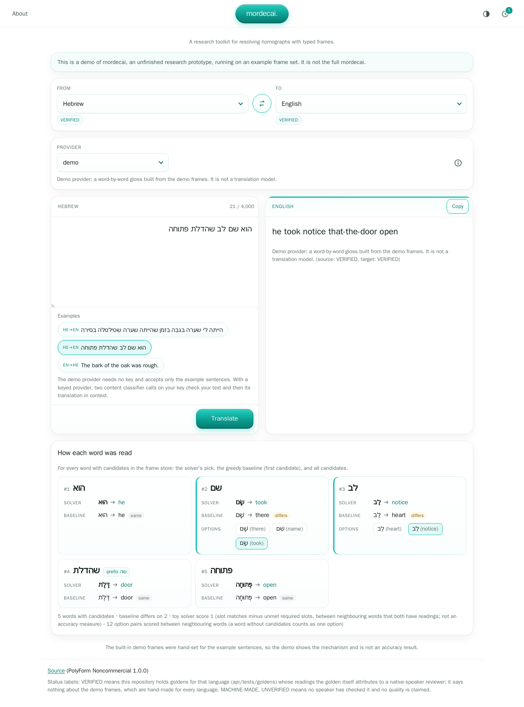

# mordecai

This public toolkit is a demo on an example frame set, not the full mordecai; for the full project, contact the author.

## Two sentences to try in your translator

Paste each sentence into the translator you use, then open the reveal to see the intended meaning.

**Hebrew**

<p dir="rtl">הוא שם לב שהדלת פתוחה</p>

<details>
<summary>Intended meaning</summary>
<p dir="ltr">He noticed the door was open.</p>
</details>

**English**

The bark of the oak was rough.

<details>
<summary>Intended meaning (in Hebrew)</summary>
<p dir="rtl">קליפת האלון הייתה מחוספסת</p>
</details>

Both sentences come from this repository's torture tests (`api/tests/goldens/torture_he.json`, items `mw-attention` and `llm-bark`). The toolkit's demo resolves both with frames hand-set for these sentences, and `api/tests/test_challenges.py` checks that on every test run.

## Try it here

The toolkit runs on your own machine from a fresh clone (see Quickstart below); the demo provider resolves both sentences with no API key.

## What it is

mordecai is a research toolkit for resolving homographs with typed frames.



## Quickstart

```sh
git clone https://github.com/roeybar/mordecai && cd mordecai
docker compose up -d --build --wait
```

Open http://localhost:8080, click an example sentence, then "Translate". No API key is needed: the demo provider runs offline on the built-in demo frames and accepts only the example sentences.

## Why it is interesting

Bare Hebrew hides its vowels, so one spelling can stand for several different words. The seed item of `api/tests/goldens/homograph_he.json` is a short sentence where the same letters appear as "hair" and as "storm", next to "eyebrow":

<p dir="rtl">הייתה לי שערה בגבה בזמן שהייתה שערה שטילטלה בסירה</p>

The gold readings for the three homographs, in order, are:

<p dir="rtl">שַׂעֲרָה / גַּבָּה / סְעָרָה</p>

A greedy reader commits to the first sense it meets and can be locally consistent but globally wrong. Solving the whole sentence at once avoids that: on the demo frames the toy solver picks all three gold readings, while the greedy baseline reads the second occurrence of the repeated spelling as "hair" again. `api/tests/test_sense_solver.py` checks both picks on every test run. The design notes are in [docs/homograph-torture-design.md](docs/homograph-torture-design.md) and [docs/global-sense-solver-spec.md](docs/global-sense-solver-spec.md).

## Architecture

```
browser -> web (nginx) -> api
                           gate        input: floor lists, then a classifier call (keyed providers)
                           S0 analyze  tokenize, candidate lattice from the frame store
                           S1 resolve  toy global solver, plus the greedy baseline
                           S2 render   provider: demo, or a keyed provider (see Configuration)
                           S3 repair   normalise the output, flag a script mismatch
                           S4 verify   chosen senses present in the output
                           gate        output: floor lists, then a classifier call (keyed providers)
```

`POST /api/translate/stream` takes the same request as `POST /api/translate`, runs the same checks and counts the same way, and answers with one JSON object per line: `{"stage": "input"}` before the input gate, `{"stage": "translate"}` before S0, `{"stage": "output"}` before S4, then the body `POST /api/translate` would return; a refusal after the first line carries its HTTP status as `"status"`. A request refused before the first stage gets the same status and body as `POST /api/translate`.

A frame is a nested JSON document with a canonical key: a hash over its semantic identity (kind, head, identity-class attributes, parts, required slots). Surfaces and features are not hashed. A controlled vocabulary is enforced when a frame is canonicalized.

## What the demo shows

The output line is a word-by-word gloss built from the demo frames, not a translation. Under the output, "How each word was read" lists each word that has candidates in the frame store, with the solver's pick, the greedy baseline (the first candidate) marked "differs" or "same", and all candidates. The demo frames (`api/mordecai/demo_data/demo_frames.json`) were hand-made for the three example sentences; their types, priors and slot bindings were hand-set for those sentences, so the demo shows the mechanism and is not an accuracy result. The solver is a toy: each slot binds the nearest word on one side, skipping function words, and an exact dynamic program picks the best assignment. Hebrew readings not taken from the goldens are hand-made and not reviewed by a speaker.

## Configuration

All variables are optional (see `.env.example`).

| Variable | Default (compose) | Meaning |
|---|---|---|
| `LOG_LEVEL` | `INFO` | log level of the api |
| `GATE_POLICY` | `strict` | which content-classifier categories refuse: `strict` all; `relaxed` child safety, sexual, weapons, illegal, fraud, self-harm; `off` child safety and sexual only; any other value counts as `strict`; the floor lists apply under every policy |
| `MAX_TEXT_CHARS` | `4000` | longest accepted input |
| `ANTHROPIC_MODEL` | `claude-haiku-5-5` | default translation model of the `anthropic` provider |
| `ANTHROPIC_MODELS` | `claude-haiku-5-5,claude-sonnet-5-5,claude-opus-5-5` | comma-separated model ids a request may pick for the `anthropic` provider; `ANTHROPIC_MODEL` is always one of them |
| `ANTHROPIC_GATE_MODEL` | `claude-haiku-5-5` | model of the `anthropic` content classifier calls |
| `XAI_MODEL` | `grok-4.20-0309-non-reasoning` | default translation model of the `xai` provider |
| `XAI_MODELS` | `grok-4.20-0309-non-reasoning,grok-4.20-0309-reasoning,grok-4.3,grok-4.7` | comma-separated model ids a request may pick for the `xai` provider; `XAI_MODEL` is always one of them |
| `XAI_GATE_MODEL` | `grok-4.20-0309-non-reasoning` | model of the `xai` content classifier calls |
| `GEMINI_MODEL` | `gemini-3.5-flash` | default translation model of the `gemini` provider, and the hosted demo's one model |
| `GEMINI_MODELS` | `gemini-3.5-flash,gemini-3.1-flash-lite,gemini-3-flash-preview,gemini-3.6-flash,gemini-3.5-flash-lite` | comma-separated model ids a request may pick for the `gemini` provider; `GEMINI_MODEL` is always one of them |
| `GEMINI_GATE_MODEL` | `gemini-3.5-flash` | model of the `gemini` content classifier calls, also on the hosted demo |
| `OPENAI_MODEL` | `gpt-6-luna` | default translation model of the `openai` provider |
| `OPENAI_MODELS` | `gpt-6-luna,gpt-6.1-sol` | comma-separated model ids a request may pick for the `openai` provider; `OPENAI_MODEL` is always one of them |
| `OPENAI_GATE_MODEL` | `gpt-6-luna` | model of the `openai` content classifier calls |
| `WEB_PORT` | `8080` | host port of the web container (bound to 127.0.0.1) |
| `FRAMES_DIR` | unset | a frame store directory in the layout FrameStore writes (`<first two hex of the key>/<key>.json`); unset means the built-in demo frames |
| `HOSTED_PROVIDER` | unset | the provider of the closed hosted demo, run on the server's own key; unset means no hosted demo (see Hosted demo below) |
| `TRUSTED_PROXIES` | unset | comma-separated CIDRs of the proxies whose X-Forwarded-For the hosted demo's per-visitor limit trusts |
| `CONTACT_EMAIL` | (empty) | the author's address, returned by `GET /api/health` as `contact` |

Bring your own key: the `anthropic`, `xai`, `gemini` and `openai` providers need a key. It goes in the `X-Provider-Key` header of the request, is used for that request only (the translation and its two content checks), and is never stored or logged.

Model and effort: a translation request may name `model`, one of the provider's `*_MODELS` ids (absent means its `*_MODEL`), and `effort`, one of the levels that model accepts (absent means its lowest level). `GET /api/providers` lists, per provider, each model with its effort levels (lowest first) and whether it is the default. The effort is the vendor's own depth control: a thinking level, a reasoning effort or an effort level. The `xai` provider and a model without a level table take no effort, and a demo request that names either field gets 400. At the lowest level, a model whose vendor allows it runs with its thinking turned off. A model the provider does not offer gets 400 `{"error": "unknown_model"}`, and an effort the model does not accept gets 400 `{"error": "unknown_effort"}`. The translation's output cap is 1024 tokens at the lowest level or for a model without a level table, and 8192 above the lowest level, because thinking counts against it.

Your own frames: build a store with mordecai.frames.FrameStore(path).put(frame) (no command in this repository does it), set FRAMES_DIR to that path inside the api container and mount it read-only, for example with a compose override file; the api opens it read-only.

Content gate: every request first passes the floor, English and Hebrew lists of child-safety and sexual terms that are refused in every context under every policy, before any classifier call, even where a term has an innocent sense (`blocklists/`; other languages are checked against the English lists). With a keyed provider, a classifier call on your key then judges the input in context, and a second call judges the translation; each answers with one category or `clean`, and `GATE_POLICY` decides which categories refuse. The classifier calls run on a fixed model per provider at its lowest effort level, whatever model and effort you pick for the translation (`ANTHROPIC_GATE_MODEL`, `XAI_GATE_MODEL`, `GEMINI_GATE_MODEL`, `OPENAI_GATE_MODEL`). For everything not on the floor the classifier judges context: "charger" is a phone accessory in one sentence and a rifle part in another, and `api/tests/test_api.py` checks both cases with canned classifier answers. The gate fails closed: if a classifier call fails or its answer is not one known category (surrounding whitespace, case, quotes and a trailing period are tolerated), the request is refused with 502 `{"error": "gate_unavailable", "stage": "input"}` (or `"output"`); a missing model id gives 503 `{"error": "provider_not_configured"}`, and on the `gemini` and `openai` providers an API answer of 429 gives 503 `{"error": "quota_exhausted"}`. Without a key there is no classifier, so the demo provider accepts only the built-in example sentences; other text gets 422 `{"error": "demo_examples_only"}`. A refused text gets 422 `{"error": "blocked_content", "category": ..., "stage": ...}`, and neither the text nor the key is logged. Cost (an estimate from the prompt length, not a measurement): the two classifier calls add about 850 input tokens plus twice the text's own token count, and at most 16 output tokens (on the `gemini` provider 256 per classifier call, 512 for the two, because the cap must leave room for thinking tokens), to each keyed request.

Hosted demo: the toolkit's author is preparing a closed, invite-only demo on a server. The app has no invite mechanism of its own: it assumes it is reachable only through a gated address that the hosting setup provides, and this repository ships no key and no invite. Setting `HOSTED_PROVIDER=gemini` adds the provider "gemini (hosted)", which runs on the server's own Gemini API key (`GEMINI_API_KEY`, free tier, set in the environment of the compose command at run time and never in a file) for both the translation and the content classifier; `docker-compose.hosted.example.yml` shows the shape. The hosted provider runs `GEMINI_MODEL` at its lowest effort level only, and its classifier calls on `GEMINI_GATE_MODEL`; a hosted request that names another model or effort gets 400 and does not count. Every provider stays available on that server, and each visitor, an IPv4 address or an IPv6 /64, gets 3 attempts in 24 hours whichever provider is used (the hosted one, a provider with the visitor's own key, or the demo provider), counted in the api's memory (a restart resets the counts); the 4th gets 429 `{"error": "demo_limit", "attempts": 3}`. A request on this server counts once it passes the request checks, whichever provider, including one that the content gate or the vendor then refuses; neither a malformed request nor a request refused because the limit is reached counts. Every provider runs the content gate there: the hosted provider's classifier runs on the server's key, a provider with the visitor's own key runs it on that key, and the demo provider is checked against the floor lists. The visitor's address comes from X-Forwarded-For only when the connecting peer is in `TRUSTED_PROXIES`. When Gemini refuses a hosted request for quota (an API answer of 429, from a daily or a per-minute limit), the request gets 503 `{"error": "quota_exhausted"}`. From Google's Gemini API Additional Terms of Service (Unpaid Services, effective March 23, 2026): "When you use Unpaid Services, including, for example, Google AI Studio and the unpaid quota on Gemini API, Google uses the content you submit to the Services and any generated responses to provide, improve, and develop Google products and services and machine learning technologies, including Google's enterprise features, products, and services, consistent with our Privacy Policy." "To help with quality and improve our products, human reviewers may read, annotate, and process your API input and output." "Do not submit sensitive, confidential, or personal information to the Unpaid Services." Invites are not issued to residents of the European Economic Area, the United Kingdom or Switzerland, or to anyone under 18. A live link follows here when the server is up. A clone without these variables has no hosted provider and no limit.

## Languages

The registry lists 16 languages. Source: Ethnologue 29th ed. (2026), plus Hebrew.

| Code | Language | Status |
|---|---|---|
| en | English | VERIFIED |
| zh | Mandarin Chinese | MACHINE-MADE, UNVERIFIED |
| hi | Hindi | MACHINE-MADE, UNVERIFIED |
| es | Spanish | MACHINE-MADE, UNVERIFIED |
| ar | Standard Arabic | MACHINE-MADE, UNVERIFIED |
| fr | French | MACHINE-MADE, UNVERIFIED |
| bn | Bengali | MACHINE-MADE, UNVERIFIED |
| pt | Portuguese | MACHINE-MADE, UNVERIFIED |
| id | Indonesian | MACHINE-MADE, UNVERIFIED |
| ur | Urdu | MACHINE-MADE, UNVERIFIED |
| ru | Russian | MACHINE-MADE, UNVERIFIED |
| de | Standard German | MACHINE-MADE, UNVERIFIED |
| ja | Japanese | MACHINE-MADE, UNVERIFIED |
| pcm | Nigerian Pidgin | MACHINE-MADE, UNVERIFIED |
| arz | Egyptian Arabic | MACHINE-MADE, UNVERIFIED |
| he | Hebrew | VERIFIED |

VERIFIED means this repository holds goldens for that language (api/tests/goldens) whose readings the golden itself attributes to a native-speaker reviewer; it says nothing about the demo frames, which are hand-made for every language. MACHINE-MADE, UNVERIFIED means no speaker has checked it, and no quality is claimed. The test samples in `api/tests/lang_samples.json` were written by this toolkit's author and are not reviewed by speakers.

## Tests

```sh
docker compose run --rm --no-deps api python -m pytest
docker compose run --rm --no-deps api python -m mordecai.eval_torture --deterministic
docker compose --profile tools run --rm check
docker compose up -d --build --wait
docker compose --profile tools run --rm e2e
```

The first command runs the api suite, the second the deterministic torture check, the third lint and the tool tests, and the last the browser tests against the running stack. The two challenge sentences are checked by `api/tests/test_challenges.py` and by the deterministic check.

Content files (the goldens, the language samples, the demo frames and the blocklists) hold text in their own scripts; every other text file in the repository is ASCII apart from Hebrew and Arabic characters (examples in tests and docs, and the prefix-letter tables in the code).

To stop it: `docker compose down`.

## Status

An unfinished research prototype.

What worked: canonical frame identity with a vocabulary check; a staged pipeline with typed hand-offs; goldens that expose the failure of greedy reading.

What did not: the general solver and the selectional resource are not built, so the larger golden item remains a coverage gap here.

Why frames need an expert: the sense inventory, the slot types and the Hebrew readings all come from a person who reads the language. Without that review the frames only repeat guesses.

## License

PolyForm Noncommercial 1.0.0 (`PolyForm-Noncommercial-1.0.0`), a source-available license: any noncommercial use is permitted. See `LICENSE`.
